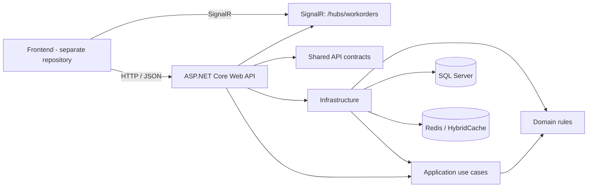
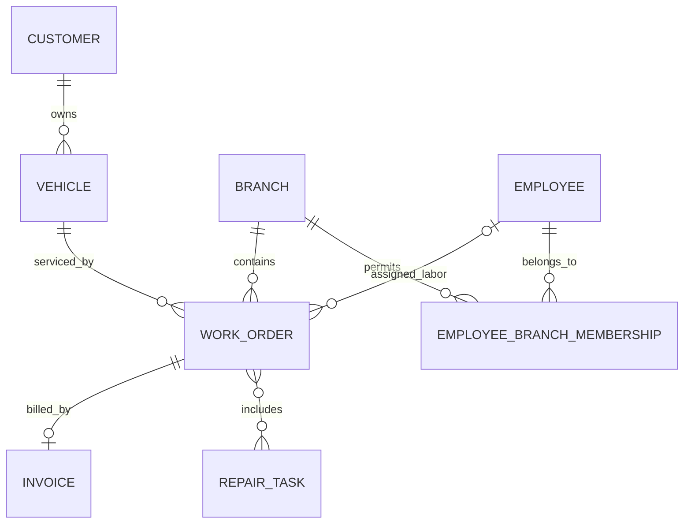

# MechanicShop

[](https://github.com/ahmedadel977/MechanicShop-V2/actions/workflows/security.yml)

**MechanicShop** is a workshop management platform for coordinating branches, customers, vehicles, employees, repair work, appointments, and billing. This repository contains the backend: a versioned ASP.NET Core REST API with role-aware access control and real-time work-order notifications. The frontend is maintained in a separate repository.

## What it does

- Manage branches, employees, customers, vehicles, repair tasks, and parts.
- Create work orders, assign labor, schedule appointments, and track repair progress.
- View daily schedules by date and time zone, plus dashboard statistics and operating hours.
- Issue invoices, record payments, and download invoice PDFs.
- Authenticate API requests with JWT bearer tokens and refresh tokens.
- Broadcast work-order changes through SignalR.

## Architecture

The backend solution separates the HTTP API, application use cases, domain rules, infrastructure, and shared API contracts. The frontend is maintained separately and consumes the versioned API over HTTP and SignalR.



## Technology

- .NET 10 and ASP.NET Core Web API
- Entity Framework Core and SQL Server
- ASP.NET Core Identity and JWT bearer authentication
- MediatR and FluentValidation
- Redis and HybridCache
- SignalR and QuestPDF
- Serilog and OpenTelemetry
- xUnit v3, Microsoft Testing Platform, Coverlet.MTP, and Testcontainers

## Get started

### Requirements

- .NET SDK 10 (the repository pins the SDK in `global.json`)
- SQL Server and Redis for local API development
- Docker Desktop or Docker Engine with Compose v2 for the full stack and API integration tests

### Run the full stack with Docker Compose

From the repository root, create a local environment file and replace all placeholder values with development secrets:

Before building or starting Compose, create and trust the local PFX and set its path/password in the ignored `.env` file using [the HTTPS setup guide](docker-compose/HTTPS.md).

```powershell
if (-not (Test-Path 'docker-compose/.env')) { Copy-Item docker-compose/.env.example docker-compose/.env }
# Edit docker-compose/.env and replace every REPLACE_WITH_... value.
docker compose --env-file docker-compose/.env -f docker-compose/docker-compose.yml -f docker-compose/docker-compose.override.yml config --quiet
docker compose --env-file docker-compose/.env -f docker-compose/docker-compose.yml -f docker-compose/docker-compose.override.yml up --build -d
```

The API is available at `https://localhost:7169` and Swagger at `https://localhost:7169/swagger`. It listens on internal HTTP `8080` and HTTPS `8443`, with only HTTPS published to the host. Seq is at `http://localhost:5341`, Prometheus at `http://localhost:9090`, and Grafana at `http://localhost:3000`. See [Docker HTTPS setup](docker-compose/HTTPS.md) for certificate creation, trust, environment variables, and verification commands.

Stop the stack with:

```powershell
docker compose --env-file docker-compose/.env -f docker-compose/docker-compose.yml -f docker-compose/docker-compose.override.yml down
```

Named data volumes are retained. The local `.env` file contains secrets and must not be committed. See [Docker and Docker Compose](docs/DOCKER.md) for configuration, migrations, operations, troubleshooting, and production guidance.

### Run the API locally

Configure local secrets with .NET User Secrets. For example:

```powershell
dotnet user-secrets set "ConnectionStrings:DefaultConnection" "<sql-server-connection-string>" --project src/MechanicShop.Api/MechanicShop.Api.csproj
dotnet user-secrets set "ConnectionStrings:Redis" "localhost:6379" --project src/MechanicShop.Api/MechanicShop.Api.csproj
dotnet user-secrets set "JwtSettings:Secret" "<random-secret-at-least-32-utf8-bytes>" --project src/MechanicShop.Api/MechanicShop.Api.csproj
dotnet user-secrets set "JwtSettings:Issuer" "MechanicShop" --project src/MechanicShop.Api/MechanicShop.Api.csproj
dotnet user-secrets set "JwtSettings:Audience" "MechanicShop.Client" --project src/MechanicShop.Api/MechanicShop.Api.csproj
dotnet user-secrets set "JwtSettings:TokenExpirationInMinutes" "60" --project src/MechanicShop.Api/MechanicShop.Api.csproj
dotnet user-secrets set "AppSettings:CorsPolicyName" "LocalClient" --project src/MechanicShop.Api/MechanicShop.Api.csproj
dotnet user-secrets set "AppSettings:AllowedOrigins:0" "https://localhost:<client-port>" --project src/MechanicShop.Api/MechanicShop.Api.csproj
```

Email delivery settings (`EmailSettings:Host`, `Port`, `SenderName`, `SenderEmail`, `Username`, and `Password`) can also be stored with User Secrets when needed. Replace placeholders with values for your environment; never commit passwords, signing keys, SMTP credentials, or production connection strings.

Restore and start the API:

```powershell
dotnet restore MechanicShop.slnx -p:RestoreProjectFilterMode=inclusionlist
dotnet run --project src/MechanicShop.Api/MechanicShop.Api.csproj
```

The solution file includes the Visual Studio Docker Compose project. The restore filter excludes that non-NuGet project while restoring the .NET projects. In Development, the API applies EF Core migrations and seeds development data at startup. Review the selected environment and database before connecting to any database containing important data.

The API health endpoint is `/health`. In Development, OpenAPI, Swagger UI, and Scalar are enabled. Work-order notifications use the SignalR hub at `/hubs/workorders`.

## API overview

Most resource routes use the `/api/v1.0` prefix.

| Resource | Capabilities |
| --- | --- |
| `workorders` | Manage work orders, labor assignments, repair tasks, status, and daily schedules. |
| `customers` | Manage customers and their vehicles. |
| `repair-tasks` | Manage repair task definitions. |
| `labors` | Retrieve labor employees. |
| `branches` | Manage branches, employees, memberships, and branch status. |
| `invoices` | Issue invoices, retrieve details, download PDFs, and record payments. |
| `dashboard` | Retrieve workshop statistics. |
| `employees` | Create employee accounts. |
| `identity` | Generate and refresh tokens and retrieve current-user claims. |
| `settings` | Retrieve operating hours. |

## Security and branch access

ASP.NET Core Identity manages user accounts, and JWT bearer authentication protects API requests. Authorization policies use authenticated roles and persisted employee and branch membership data. Work-order and invoice queries are scoped to the current user's branch access.

Client-supplied roles, access scopes, or branch identifiers are not trusted as authorization sources. Keep application secrets outside source control and configure allowed CORS origins for each environment. The JWT audience value `MechanicShop.Client` is a configured logical identifier for token validation, not a frontend project reference.

## Tests

The solution includes unit, subcutaneous, and API integration test projects. API integration tests launch isolated SQL Server and Redis containers with Testcontainers, so Docker must be running.

Run all tests from the repository root:

```powershell
dotnet test MechanicShop.slnx
```

To generate TRX test reports using the Microsoft Testing Platform runner:

```powershell
dotnet test MechanicShop.slnx --results-directory TestResults -- --report-trx
```

## Continuous integration

The [GitHub Actions workflow](.github/workflows/security.yml) runs on pushes and pull requests targeting `master` or `develop`, and can also be started manually. It restores and builds the solution, runs the full test suite, uploads TRX results, scans NuGet dependencies for vulnerabilities, scans the repository for secrets, and validates the API Docker image build.

## Solution layout

| Path | Purpose |
| --- | --- |
| `src/MechanicShop.Api` | HTTP endpoints, authentication, OpenAPI, health checks, and hosting. |
| `src/MechanicShop.Application` | Commands, queries, handlers, validation, and use cases. |
| `src/MechanicShop.Domain` | Domain entities and business rules. |
| `src/MechanicShop.Infrastructure` | EF Core, SQL Server, Identity, Redis, PDF generation, and integrations. |
| `src/MechanicShop.Contracts` | Shared API request and response contracts. |
| `tests` | API integration, application, domain, and shared test projects. |
| `docs` | Operational and Docker Compose documentation. |

This solution contains backend projects only; the frontend is maintained separately.

## Data model

Customers can own multiple vehicles. Work orders belong to a branch and vehicle, may be assigned to a labor employee, and can include multiple repair tasks. An invoice is associated with a work order. Employee branch memberships define branch access and can identify a default branch.



EF Core entity configurations live in `src/MechanicShop.Infrastructure/Date/Configurations`, and schema changes are managed through migrations. Work orders and invoices use global query filters for branch access; code that bypasses those filters should be reviewed carefully.
