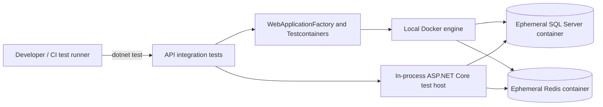
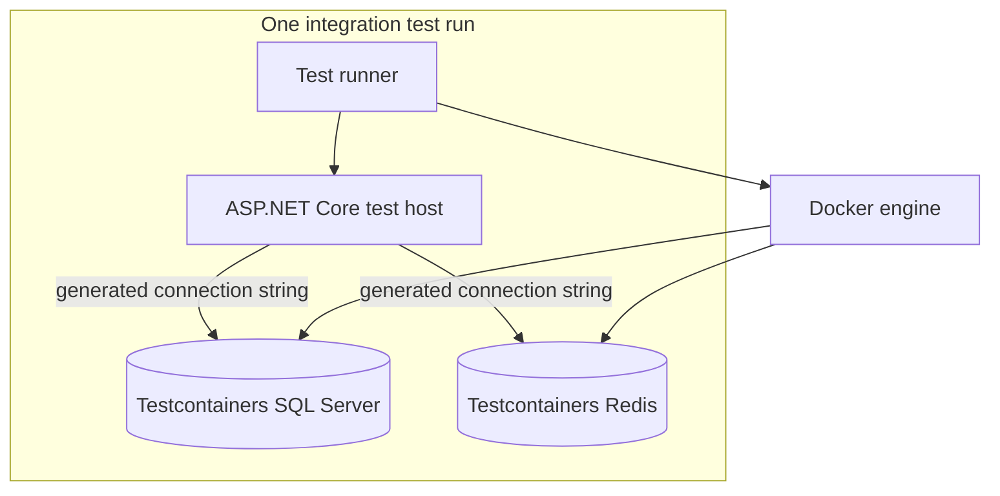

# Docker and Containerization

## Current repository support

This guide describes Docker-related files that are actually tracked on the promoted `master` branch. The branch has no `Dockerfile`, `.dockerignore`, Docker Compose YAML, Compose override, Compose project, or `.env.example`. The untracked local Docker files visible in some working copies are not part of this branch and are not included in its deployment instructions.

The tracked API project has a Visual Studio Docker launch profile and Docker-related project properties, but this is not a complete container build: there is no tracked Dockerfile for that profile. The project currently records `DockerDefaultTargetOS` as `Windows`, an absolute `DockerfileContext` path, and a Docker launch profile with `ASPNETCORE_URLS=http://+:8080`. These settings need review before they can be used reproducibly on another machine.

Docker is used by automated integration tests through Testcontainers. The API integration test factory starts SQL Server (`mcr.microsoft.com/mssql/server:2022-latest`) and Redis (`redis:7-alpine`) containers as test dependencies, obtains dynamically mapped ports, and disposes of those containers after the test fixture ends. The application itself runs in the test host; it is not built into an API container by the tracked configuration.

## Docker concepts

Docker builds images from a Dockerfile and runs those images as containers. Containers provide isolated processes and networking, while images provide a repeatable application package. Docker Compose describes multiple cooperating containers, their networks, volumes, configuration, health checks, and startup dependencies.

MechanicShop currently uses containers for tests, not for a committed multi-service application deployment. The project references SQL Server and Redis as application dependencies; the Testcontainers fixture creates those dependencies for tests. It does not define a long-running Compose network or persistent volumes.

## Dockerfile and multi-stage builds

There is no tracked Dockerfile to explain line by line, and no tracked multi-stage image build. The Visual Studio Docker launch profile is not itself an image definition. A reproducible application image would require a Dockerfile that restores and publishes the .NET solution and copies the published API into a runtime image. That implementation has not been committed, so no base image, build stage, runtime port, health check, user, or entrypoint is specified here.

## Compose services and architecture

There is no tracked `docker-compose.yml` or Compose override, so this branch defines no Compose services. In particular, no published API, database, Redis, logging, metrics, or dashboard ports are configured for a deployment. The only container services established by the tracked test code are SQL Server and Redis, started temporarily by Testcontainers. Their host ports are dynamically mapped by the test framework rather than fixed in repository configuration.

The test containers communicate with the test host using connection details supplied by Testcontainers. This is separate from application deployment networking. No service-name DNS names, fixed host mappings, Compose networks, or cross-container production route are configured in the tracked repository.

## SQL Server and Redis in tests

`tests/MechanicShop.Api.IntegrationTests/Common/WebAppFactory.cs` creates a SQL Server container from the `2022-latest` image and a Redis container from `7-alpine`. It starts them for the test fixture, reads their mapped endpoints, and supplies the resulting connection strings to the in-process API host. The test fixture also supports pausing and resuming Redis to exercise health behavior.

The application Infrastructure project registers SQL Server and Redis health checks, and the API exposes `/health`. Integration tests assert the dependency statuses. These are application and test behaviors; they do not imply that a Compose health check or container health check is configured.

Testcontainers owns the lifecycle of its disposable test containers. No named data volumes or persistence configuration is tracked for these test instances. Do not use test data containers for durable application data.

## Configuration and secrets

There are no Docker Compose environment variables or tracked Docker `.env` template on this branch. The application uses its ASP.NET Core configuration system. For local host-based development, use the configuration keys documented in the root README and .NET User Secrets; do not put credentials in source control.

The test fixture supplies container connection details programmatically. Test credentials should remain test-only. Production credentials belong in a deployment secret manager or the hosting platform's secret facility, not in an image, Docker build argument, source-controlled file, or command history.

## Networking, ports, volumes, and health checks

Testcontainers chooses and reports mapped host ports at runtime. Tests must use the generated host and port rather than assume a fixed port. There is no committed Compose network, explicit published application port, or volume declaration. The API `/health` endpoint reports the SQL Server and Redis dependency checks; the tracked test code uses it to verify health responses. No Docker `HEALTHCHECK` instruction exists in the tracked branch.

## Commands

Install Docker Desktop or Docker Engine and start its daemon before running tests that use Testcontainers. Check the engine:

~~~powershell
docker version
~~~

Run the API integration test project from the repository root:

~~~powershell
dotnet test tests/MechanicShop.Api.IntegrationTests/MechanicShop.Api.IntegrationTests.csproj
~~~

The application subcutaneous test project also uses Testcontainers SQL Server:

~~~powershell
dotnet test tests/MechanicShop.Application.SubcutaneiousTests/MechanicShop.Application.SubcutaneiousTests.csproj
~~~

These tests may download container images on the first run. Their lifecycle is controlled by the test fixture. The repository does not provide Compose commands to start or stop a development or production stack. `docker compose config --quiet` cannot validate a project configuration that is absent from the tracked branch.

## EF Core migrations

The application uses EF Core SQL Server migrations. Its database initializer applies migrations during Development startup, as documented in the root README. The Testcontainers fixtures provide isolated databases for automated tests. There is no container entrypoint, Compose migration service, or deployment migration job in this branch. Production migrations should be reviewed and run as a controlled release step after a deployment process is selected.

## Logging and troubleshooting

For Testcontainers failures, confirm that the Docker daemon is running, that the current user can access it, and that the engine can pull the SQL Server and Redis images used by the test fixture. Check test output for image-pull, container-start, and mapped-port errors. Avoid assuming that a previously allocated test port remains valid.

The tracked application health endpoint reports SQL Server and Redis check states. A failing health check can indicate an unavailable test container or an incorrect generated connection string. Inspect the test fixture and test output before changing application configuration.

## Security and production readiness

The tracked Docker setup is not a production deployment definition. Before containerizing the API, add and review a Dockerfile and deployment configuration; use a supported runtime image, non-root execution, pinned image versions, vulnerability scanning, and a small build context. Configure TLS at an approved ingress, least-privilege database credentials, secret injection, network restrictions, resource limits, backups, log retention, health probes, and a reviewed migration strategy.

These are recommendations, not current repository behavior. Do not infer service ports, environment variable names, volumes, container health checks, or Compose dependencies until those settings are added and reviewed in the repository.

## Deployment status

There is no complete Docker deployment guide to execute against the current tracked files because the API image and Compose stack are not defined. The available Docker workflow is for Testcontainers-based automated tests. A future deployment change should add the Docker build and runtime configuration first, then update this guide from those checked-in files and validate it with Docker Compose.
