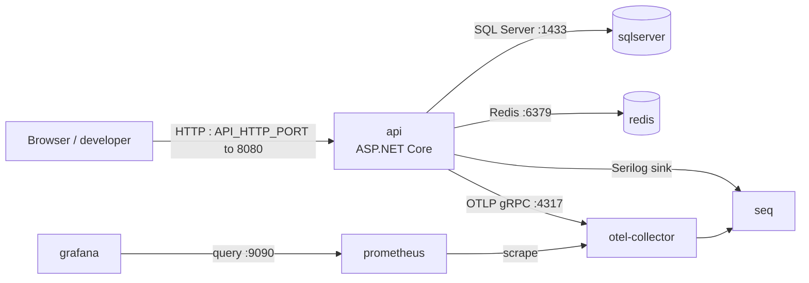
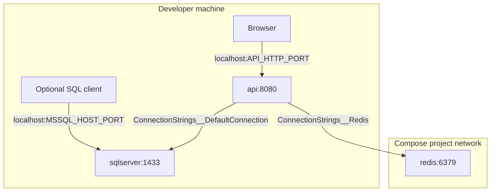
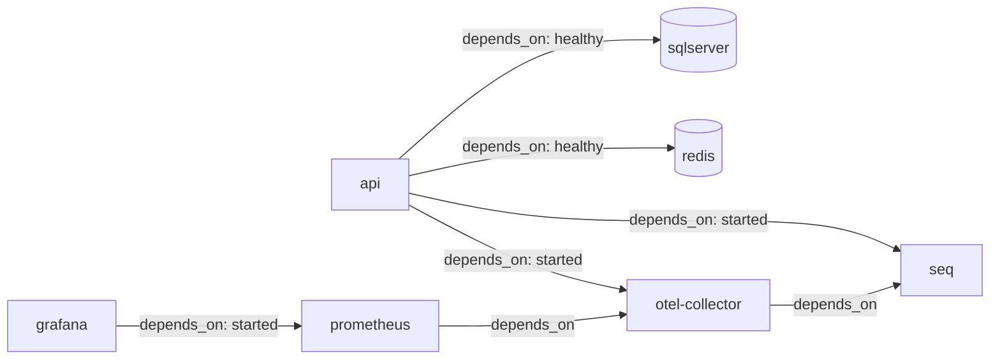

# Docker and Docker Compose

This guide describes the Docker setup present in this repository. It covers local development and the limits of the current Compose deployment; it does not imply that the Compose stack is production hardened.

## 1. Docker and containerization

Docker packages an application and its runtime into an image. A container runs an image with isolated processes, filesystem, networking, and configuration. Compose declares a multi-container application so its services, networks, volumes, startup dependencies, and port mappings can be managed together.

MechanicShop's Compose file builds the ASP.NET Core API image and runs it with SQL Server, Redis, Seq, the OpenTelemetry Collector, Prometheus, and Grafana. The Blazor WebAssembly client is served by the API project; there is no separate client container in this Compose setup.

## 2. Architecture in this repository

The Compose project is in `docker-compose/`. The main file defines all services and named data volumes. `docker-compose.override.yml` adds local development settings and publishes selected service ports to the host. Compose loads both files by default when the main file is named `docker-compose.yml` and the override is alongside it.



### Service inventory

| Service | Image / build | Purpose and internal ports | Host port in development override |
| --- | --- | --- | --- |
| `api` | Built from `src/MechanicShop.Api/Dockerfile` | HTTP API and Blazor client on 8080 | `${API_HTTP_PORT:-8080}:8080` |
| `sqlserver` | SQL Server 2022 CU28 | Application database on 1433 | `${MSSQL_HOST_PORT:-1433}:1433` |
| `redis` | Redis 7.4.11 Alpine | Cache on 6379; AOF and periodic snapshots enabled | `${REDIS_HOST_PORT:-6379}:6379` |
| `seq` | Seq 2026.1.17526 | Log ingestion on 5341; web UI on 80 | UI `${SEQ_HOST_PORT:-5341}:80`; ingestion `${SEQ_INGEST_HOST_PORT:-5342}:5341` |
| `otel-collector` | OpenTelemetry Collector Contrib 0.165.0 | OTLP gRPC 4317, HTTP 4318, metrics 9464 | Not published to host |
| `prometheus` | Prometheus 3.15.1 | Metrics UI and query API on 9090; 15-day retention | `${PROMETHEUS_HOST_PORT:-9090}:9090` |
| `grafana` | Grafana 13.3.0 | Dashboards on 3000 | `${GRAFANA_HOST_PORT:-3000}:3000` |

These mappings come from the checked-in Compose files. Values may be overridden by environment configuration. The default API host port in the Compose file is 8080, while the supplied local `.env.example` chooses 5106.

## 3. Dockerfile, line by line

`src/MechanicShop.Api/Dockerfile` uses three stages:

1. `FROM mcr.microsoft.com/dotnet/aspnet:10.0.12 AS base` selects the .NET 10 ASP.NET Core runtime for the final image.
2. `WORKDIR /app` sets the runtime working directory.
3. `ENV ASPNETCORE_HTTP_PORTS=8080` configures Kestrel's HTTP listener.
4. `EXPOSE 8080` documents the container port; Compose performs the actual host publication.
5. `USER 0` temporarily switches to root to install the health-check tool.
6. `RUN apt-get ... curl ...` installs curl and removes apt package lists to reduce leftover image data.
7. `HEALTHCHECK ... curl ... /health` checks the API every 30 seconds, with a 90-second startup allowance and five retries.
8. `USER $APP_UID` drops back to the non-root application user supplied by the .NET base image.
9. `FROM mcr.microsoft.com/dotnet/sdk:10.0.401 AS build` starts the SDK build stage.
10. `ARG BUILD_CONFIGURATION=Release` allows the publish configuration to be overridden at build time.
11. `WORKDIR /src` establishes the source root inside the build image.
12. `COPY` of `global.json`, NuGet configuration, shared props, and each project file copies dependency metadata first for better restore-layer caching.
13. `RUN dotnet restore ...` restores the API and its project references.
14. `COPY . .` copies the remaining build context, subject to `.dockerignore`.
15. `RUN dotnet publish ... --no-restore` publishes the API and referenced projects to `/app/publish` without repeating restore.
16. `FROM base AS final` creates a clean runtime image, excluding the SDK and source tree.
17. `COPY --from=build --chown=...` copies only published output and assigns it to the non-root application user.
18. `ENTRYPOINT` starts `MechanicShop.Api.dll` with `dotnet`.

This is a multi-stage build: SDK tooling and source are in the intermediate build stage, while the final stage contains the ASP.NET Core runtime and published application. It pins the SDK/runtime tags but does not pin image digests.

`.dockerignore` excludes Git metadata, build outputs, tests, documentation, logs, user-specific IDE files, and development appsettings. It also excludes `.env` files. Keep secret files outside the image build context regardless of ignore rules.

## 4. Compose communication and networking

Compose creates a project-scoped default bridge network. Services can resolve each other by service name, so the API uses `sqlserver:1433` and `redis:6379`; containers should not use `localhost` to reach another service. The `expose` entries document internal ports but do not publish them on the host. Only `ports` entries in the override make services host-accessible during local development.



The API-to-database connection string is injected by Compose and targets the `sqlserver` service. SQL Server is only exposed internally in the main file; the override publishes it for local tools. The API does not publish a dedicated Redis endpoint, though the override publishes Redis for local diagnostics.



Startup ordering is not the same as runtime availability. Compose waits for SQL Server and Redis health before starting the API because those dependencies have `service_healthy` conditions. Seq and the collector use `service_started`, which only means their containers started. The application and monitoring clients still need sensible reconnect and failure handling.

## 5. SQL Server and EF Core migrations

The `sqlserver` service uses SQL Server 2022 CU28 on Ubuntu. Compose sets `ACCEPT_EULA`, `MSSQL_PID` (Developer by default), and `MSSQL_SA_PASSWORD`. A health check runs `sqlcmd` with the configured password and retries until SQL Server accepts a query. SQL data persists in the named `sqlserver-data` volume mounted at `/var/opt/mssql`.

The API connection string selects database `MechanicShopDb`, uses the `sa` login, and enables encryption with `TrustServerCertificate=True` for this local container network. This certificate setting is not a production TLS configuration.

`ApplicationDbContextInitialiser` applies EF Core migrations and seeds data when `InitialiseDatabaseAsync` is called. In the API startup code this call is inside the Development environment branch. The supplied Compose override sets `ASPNETCORE_ENVIRONMENT=Development`, so local Compose startup applies migrations and development seeding. The base Compose file defaults to Production; if run without the override, this startup migration call is not made. Review the API startup and initializer before changing environments.

For EF Core CLI inspection, the Infrastructure project is the migrations target and the API is the startup project. Use a repository-approved EF CLI version:

~~~powershell
dotnet tool install --global dotnet-ef
dotnet ef migrations list --project src/MechanicShop.Infrastructure/MechanicShop.Infrastructure.csproj --startup-project src/MechanicShop.Api/MechanicShop.Api.csproj
~~~

The runtime image does not include the EF CLI or SDK. Create migrations with the .NET SDK on the host (or in a dedicated SDK container) using the same project paths. For deployments, run reviewed migrations as a controlled release step; do not depend on every API replica attempting schema changes during startup.

## 6. Redis

The API configures Redis-backed caching using `ConnectionStrings:Redis`; Compose supplies `redis:6379`. The Redis service enables append-only persistence and snapshots, stores data in `redis-data`, and uses `redis-cli ping` for health. The override exposes Redis to the host for local diagnostics. The Compose configuration does not define Redis authentication or TLS; do not expose this configuration to untrusted networks.

## 7. Configuration and secrets

The Compose file requires values for `MSSQL_ACCEPT_EULA`, `MSSQL_SA_PASSWORD`, `JWT_SECRET`, `SEQ_ACCEPT_EULA`, `SEQ_ADMIN_PASSWORD`, and `GRAFANA_ADMIN_PASSWORD`. It also supports optional image, SQL edition, admin username, and host port settings. Defaults are shown in the Compose expressions and in `docker-compose/.env.example`.

| Variable | Used by | Meaning |
| --- | --- | --- |
| `API_IMAGE` | `api` | Optional API image tag; defaults to `mechanicshop-api:local`. |
| `ASPNETCORE_ENVIRONMENT` | `api` | Defaults to Production in the base file; the development override sets Development. |
| `API_HTTP_PORT` | `api` | Optional host port mapped to API container port 8080. |
| `MSSQL_ACCEPT_EULA` | `sqlserver` | Required explicit SQL Server license acceptance. |
| `MSSQL_PID` | `sqlserver` | SQL Server edition; defaults to Developer. Review licensing before selecting an edition. |
| `MSSQL_SA_PASSWORD` | `sqlserver`, API connection | SQL Server `sa` password; used by the API connection string and required. |
| `MSSQL_HOST_PORT` | `sqlserver` override | Optional host port mapped to 1433. |
| `REDIS_HOST_PORT` | `redis` override | Optional host port mapped to 6379. |
| `JWT_SECRET` | `api` | Required JWT signing secret; application validation requires at least 32 UTF-8 bytes. |
| `SEQ_ACCEPT_EULA` | `seq` | Required explicit Seq license acceptance. |
| `SEQ_ADMIN_USER` | `seq` | First-run Seq administrator name; defaults to `admin`. |
| `SEQ_ADMIN_PASSWORD` | `seq` | Required first-run Seq administrator password. |
| `SEQ_HOST_PORT` | `seq` override | Optional host port mapped to Seq web port 80. |
| `SEQ_INGEST_HOST_PORT` | `seq` override | Optional host port mapped to Seq ingestion port 5341. |
| `GRAFANA_ADMIN_USER` | `grafana` | First-run Grafana administrator name; defaults to `admin`. |
| `GRAFANA_ADMIN_PASSWORD` | `grafana` | Required Grafana administrator password. |
| `PROMETHEUS_HOST_PORT` | `prometheus` override | Optional host port mapped to 9090. |
| `GRAFANA_HOST_PORT` | `grafana` override | Optional host port mapped to 3000. |

The Compose file also sets `ConnectionStrings__DefaultConnection`, `ConnectionStrings__Redis`, `JwtSettings__Secret`, `OTEL_SERVICE_NAME`, `OTEL_EXPORTER_OTLP_ENDPOINT`, `Serilog__WriteTo__1__Args__serverUrl`, and `ASPNETCORE_HTTP_PORTS` directly for the API. These are container configuration keys, not extra values from the supplied `.env.example`.

Create a local environment file from the example only if one does not already exist. The example uses explicit `REPLACE_WITH_...` placeholders for required passwords; set strong, unique values before starting the stack. The actual local `.env` is ignored by Git and must not be committed or copied into an image. If any credential has been used outside a disposable local setup, rotate it.

```powershell
if (-not (Test-Path 'docker-compose/.env')) { Copy-Item docker-compose/.env.example docker-compose/.env }
# Edit docker-compose/.env in a text editor and replace the REPLACE_WITH_... placeholders.
```

Compose substitutes `.env` values into the container environment. This is convenient for local development, but environment variables can be visible to users with Docker access and may appear in diagnostics. For production, use the deployment platform's secret manager or Docker secrets where supported, least-privilege database credentials, managed identity where available, and a dedicated signing key per environment. Do not put production secrets in source control, image layers, command history, tickets, or logs.

`src/MechanicShop.Api/appsettings.json` contains non-secret application defaults. ASP.NET Core environment variables use double underscores for nested keys, for example `JwtSettings__Secret` maps to `JwtSettings:Secret`. Do not mount the development appsettings file into the production container.

## 8. Volumes and persistence

Named volumes persist data independently of a container's writable layer:

| Volume | Service | Container path | Content |
| --- | --- | --- | --- |
| `sqlserver-data` | SQL Server | `/var/opt/mssql` | Database files |
| `redis-data` | Redis | `/data` | AOF and snapshot data |
| `seq-data` | Seq | `/data` | Seq state and log data |
| `prometheus-data` | Prometheus | `/prometheus` | Time-series data, subject to 15-day configured retention |
| `grafana-data` | Grafana | `/var/lib/grafana` | Grafana state |

The Collector configuration and Prometheus/Grafana provisioning are bind-mounted read-only from the repository. Removing a container does not remove named volumes. `docker compose down -v` deletes the Compose project's named volumes and is destructive; back up databases and monitoring state before using it.

## 9. Prerequisites and quick start

Install Docker Desktop (or Docker Engine with the Compose v2 plugin) and ensure the daemon is running. On Windows, Docker Desktop should be configured for Linux containers. Install the .NET 10 SDK if you will build or run the solution outside Docker.

From the repository root, create and edit the local environment file as described above, then validate and start:

```powershell
if (-not (Test-Path 'docker-compose/.env')) { Copy-Item docker-compose/.env.example docker-compose/.env }
# Edit docker-compose/.env to replace the REPLACE_WITH_... placeholders first.
docker compose --env-file docker-compose/.env -f docker-compose/docker-compose.yml -f docker-compose/docker-compose.override.yml config --quiet
docker compose --env-file docker-compose/.env -f docker-compose/docker-compose.yml -f docker-compose/docker-compose.override.yml up --build -d
```

Open the API at `http://localhost:5106` when using the supplied example port. Swagger UI and Scalar are mapped only in Development. Seq is available at `http://localhost:5341`, Prometheus at `http://localhost:9090`, and Grafana at `http://localhost:3000`, subject to host port overrides. The API health endpoint is `http://localhost:5106/health`.

## 10. Common Docker commands

Use the same `--env-file` and `-f` arguments consistently:

```powershell
$compose = @("--env-file", "docker-compose/.env", "-f", "docker-compose/docker-compose.yml", "-f", "docker-compose/docker-compose.override.yml")
docker compose @compose ps
docker compose @compose logs -f api
docker compose @compose logs --tail 100 sqlserver
docker compose @compose restart api
docker compose @compose pull
docker compose @compose build --no-cache api
docker compose @compose down
```

To stop and remove containers and the network while retaining data, use `down`. To remove persistent data as well, `down -v` will erase all Compose named volumes. To check application readiness, request `/health` and inspect `docker compose ps` and `docker compose logs`.

## 11. Development workflow

1. Start Docker Desktop and create a reviewed local `docker-compose/.env`.
2. Validate the Compose model with `config --quiet`.
3. Run `up --build -d` and wait for SQL Server and Redis health checks.
4. Follow API logs until migration and startup complete; in Development, database migration and seed initialization occur at startup.
5. Use the API, Blazor client, and local monitoring tools through the published host ports.
6. Make source changes and rebuild the API with `docker compose ... up --build -d api`.
7. Shut down with `docker compose ... down`; named data remains unless `-v` is supplied.

For host-based development, use the project launch settings and configure database, Redis, and JWT values separately. A container's `localhost` means that container itself; use the Compose service names from other containers and `localhost` plus a published host port from the developer machine.

## 12. Health, logs, and troubleshooting

The API maps `/health` and reports registered health-check names and statuses as JSON. The Dockerfile health check calls that endpoint. The API's dependency health checks are registered in Infrastructure. Compose independently checks SQL Server, Redis, and Prometheus. `depends_on` with a healthy condition gates initial API startup for SQL Server and Redis.

Useful diagnostics:

```powershell
docker compose @compose ps
docker compose @compose logs -f api sqlserver redis
docker compose @compose exec api printenv ASPNETCORE_ENVIRONMENT
docker compose @compose exec sqlserver /opt/mssql-tools18/bin/sqlcmd -S localhost -U sa -C -Q "SELECT 1"
```

Common issues:

- **Required variable missing:** Compose reports a required value; check the selected `--env-file` and variable name without printing secrets into shared logs.
- **Port already in use:** change the corresponding host port variable in the local `.env`; the container port remains the right-hand side of the mapping.
- **API cannot connect to SQL Server or Redis:** inside Compose, use service names `sqlserver` and `redis`, confirm health, and inspect API/service logs.
- **Database login failure:** verify the SQL password used by both SQL Server and the API connection string. Existing SQL data in the named volume retains the original initialization credentials; changing `.env` alone does not reset it.
- **Migration failure:** inspect API logs and migration state. Back up data and review migrations before any destructive database action.
- **Stale configuration or image:** rebuild the API and verify that the intended Compose files and env file are being used.
- **Cannot open Seq/Grafana/Prometheus:** confirm the service is running and check host port conflicts and `.env` port overrides.

Avoid posting `docker compose config` output publicly because it may render resolved credentials. `config --quiet` validates without printing the expanded configuration.

## 13. Production considerations and recommended improvements

The current Compose setup is useful for local development and testing observability. Before production use:

- Store secrets in a dedicated secret manager and rotate credentials regularly.
- Do not use the SQL Server `sa` account for the application. Create a least-privilege database principal and define a deliberate certificate validation/TLS policy.
- Decide how migrations are applied as a controlled deployment step, and test rollback/recovery procedures.
- Pin container images by digest, scan images and dependencies, and update base images through a reviewed patch process.
- Keep SQL Server, Redis, Seq, Prometheus, Grafana, and Collector endpoints on private networks; publish only intended ingress through a TLS-terminating proxy or platform load balancer.
- Configure authentication, TLS, access control, and network restrictions for Seq and Grafana. The current stack has no Grafana sign-up but still uses an admin password supplied through environment configuration.
- Set CPU/memory limits, log and disk retention, backups, restore drills, alerts, and monitoring for the host and volumes.
- Review whether container health checks expose only suitable diagnostic information and whether orchestration restart policies match the hosting platform.
- Use an orchestrator or managed services for availability, secret delivery, scaling, backups, and rolling deployments where the service requirements justify them.

These are recommendations, not features configured by the checked-in Compose files.

## 14. Complete deployment sequence

For a local deployment, follow the Quick Start and verify `/health`, API logs, database initialization, and monitoring endpoints. For a production deployment, first create a reviewed environment-specific deployment configuration with secure ingress, durable storage and backups, secret injection, image digests, resource limits, and a migration release step. Build and scan the image in CI, publish it to a private registry, deploy the immutable image, verify health and logs, and keep a tested rollback plan. The current Compose configuration alone does not provide production secrets management, TLS ingress, backup automation, or a migration job.

## 15. Configuration files

- `src/MechanicShop.Api/Dockerfile`: API multi-stage image build and container health check.
- `.dockerignore`: excludes local/build/test/documentation files from build context.
- `docker-compose/docker-compose.yml`: services, internal connectivity, required environment, health checks, and named volumes.
- `docker-compose/docker-compose.override.yml`: local Development mode and host port publication.
- `docker-compose/.env.example`: variable names and placeholder values for local setup.
- `otel-collector/otel-collector.yml`, `prometheus/prometheus.yml`, and `grafana/`: monitoring configuration mounted by the stack.
- `global.json`, `Directory.Build.props`, `Directory.Packages.props`, and `NuGet.Config`: SDK selection and shared .NET build/package configuration consumed by the Docker build.
