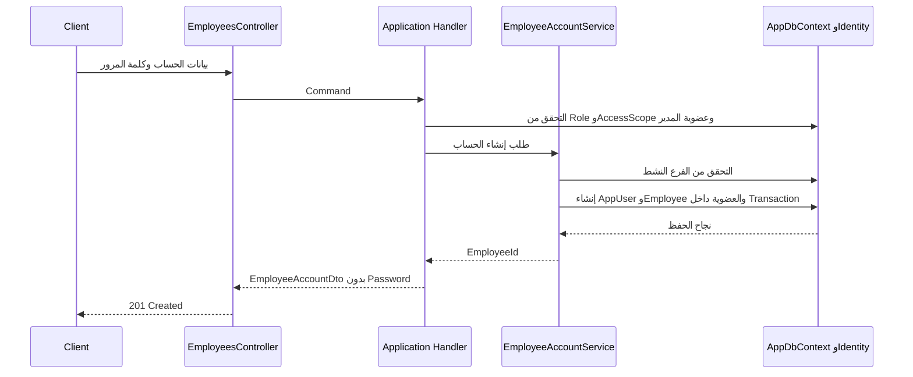

# مراجعة كود إنشاء حسابات الموظفين وCompany Manager Bootstrap

## نطاق المراجعة

المراجعة دي خاصة بآخر تعديل فقط: إنشاء حسابات `Labor` و`Branch Manager`، كلاس `EmployeeAccountDto`، وإنشاء أول `Company Manager` من خلال `CompanyManagerBootstrapper`. باقي تغييرات المشروع خارج النطاق.

## الخلاصة

التدفق الأساسي متماسك: الـAPI يستقبل بيانات الإنشاء، والـHandler يتحقق من صلاحية المستخدم الحالي من قاعدة البيانات، وبعدها `EmployeeAccountService` ينشئ حساب Identity والموظف وعضوية الفرع داخل معاملة واحدة. الاختبارات تفحص الصلاحيات، الفرع غير النشط، البريد المكرر، تطابق الـIDs، تخزين كلمة المرور كـhash، والعضوية الافتراضية.

`EmployeeAccountDto` لا يحتوي على `Password`، وده قرار صحيح؛ كلمة المرور لا ترجع للعميل بعد الإنشاء. ASP.NET Identity يخزن `PasswordHash`، أما كلمة مرور الـBootstrap فتُحفظ في ملف محلي خارج الـrepository.

## مسار إنشاء حساب Labor أو Branch Manager

1. `EmployeesController` يستقبل `CreateLaborRequest` أو `CreateBranchManagerRequest` ويرسل Command إلى MediatR.
2. `CreateLaborCommandHandler` يسمح لمدير الفرع بإنشاء Labor داخل فرع له عضوية فيه، ويسمح لمدير الشركة بالإنشاء في الفروع النشطة.
3. `CreateBranchManagerCommandHandler` يشترط أن يكون المستخدم الحالي `Manager + Company`.
4. `EmployeeAccountService` يتأكد أن الفرع نشط، وينشئ `AppUser` و`Employee` و`EmployeeBranchMembership`، ثم يحفظها ضمن Database Transaction.
5. الـAPI يرجع `EmployeeAccountDto` من غير كلمة المرور.

## مسار Bootstrap

`CompanyManagerBootstrapper` يعمل فقط في `Development`. يقرأ البريد من `Bootstrap:CompanyManagerEmail`، يتأكد من عدم وجود الحساب أو Company Manager سابق، ويولد Password عشوائيًا باستخدام `RandomNumberGenerator`. بعدها ينشئ حساب Identity ودور `Manager` وسجل Employee بصلاحية `Company` وبنفس الـID، ويحفظهم داخل Transaction.

ملف بيانات الاعتماد يُحفظ تحت `LocalApplicationData/MechanicShop/bootstrap`، وليس ضمن ملفات المشروع. التطبيق لا يكتب كلمة المرور في Log.

## الملفات الأساسية التي تمت مراجعتها

| الملف | دوره في التعديل |
| --- | --- |
| `MechanicShop.Api/Controllers/EmployeesController.cs` | نقاط API لإنشاء Labor وBranch Manager، مع سياسات الوصول. |
| `MechanicShop.Application/Features/Employees/Commands/CreateLabor/CreateLaborCommandHandler.cs` | يتحقق من صلاحية المدير ونطاق فروعه قبل إنشاء Labor. |
| `MechanicShop.Application/Features/Employees/Commands/CreateBranchManager/CreateBranchManagerCommandHandler.cs` | يقصر إنشاء مدير فرع على Company Manager. |
| `MechanicShop.Infrastructure/identity/EmployeeAccountService.cs` | ينشئ Identity user والـDomain Employee وعضوية الفرع داخل Transaction. |
| `MechanicShop.Application/Features/Employees/Dtos/EmployeeAccountDto.cs` | بيانات الاستجابة، من غير كلمة مرور. |
| `MechanicShop.Infrastructure/identity/CompanyManagerBootstrapper.cs` | Bootstrap محلي لمرة واحدة لحساب Company Manager الأول. |
| `MechanicShop.Infrastructure/Date/ApplicationDbContextInitialiser.cs` | يشغل Bootstrap في Development بعد تهيئة قاعدة البيانات والأدوار. |
| `tests/MechanicShop.Api.IntegrationTests/Controllers/EmployeesControllerTests.cs` | اختبارات API للحسابات والصلاحيات والحفظ. |
| `tests/MechanicShop.Application.UniTests/Features/Employees/` | اختبارات Validators للأوامر الجديدة. |

## ملاحظات المراجعة

### ملاحظات تحتاج متابعة

1. **حماية ملف كلمة مرور Bootstrap:** الملف يحتوي كلمة المرور كنص صريح خارج الـrepository، لكن الكود لا يضبط ACL صريحًا عليه. الحماية تعتمد على صلاحيات المجلد الافتراضية في نظام التشغيل. قبل استخدام التدفق على جهاز مشترك، يفضّل فرض صلاحيات قراءة للمستخدم الحالي فقط أو حفظ السر في Credential Manager. لم يتم تعديل هذا السلوك ضمن المراجعة.
2. **اختبارات Bootstrap قابلة للتكرار:** اختبارات `EmployeesControllerTests` تغطي واجهات إنشاء الموظفين، لكنها لا تختبر `CompanyManagerBootstrapper` مباشرةً، مثل تكرار التشغيل، رفض بيئة غير Development، ملف اعتماد تالف، أو وجود Company Manager سابق. تشغيل Bootstrap على قاعدة التطوير والتحقق من الحساب حصل يدويًا، لكنه لا يغني عن اختبار آلي مستقل.
3. **سياسة كلمة مرور حسابات الموظفين:** Validators تسمح بحد أدنى 6 أحرف، وإعدادات Identity الحالية تسمح بذلك. ده متوافق بين التطبيق وIdentity، لكنه حد أدنى منخفض لحسابات حقيقية؛ الأفضل مراجعة سياسة كلمات المرور قبل إتاحة إنشاء الحسابات في بيئة إنتاجية.

### نقاط اتأكدت منها

- لا يوجد `Password` في `EmployeeAccountDto`، ولا تُعاد كلمة المرور في استجابة الإنشاء.
- `EmployeeAccountService` يستخدم `UserManager.CreateAsync` لتخزين PasswordHash بدل النص الصريح.
- `AppUser.Id` يساوي `Employee.Id`، والاختبار يتحقق من تطابقهما.
- إنشاء الحساب والعضوية محفوظان ضمن Transaction واحدة.
- `CreateLaborCommandHandler` لا يعتمد على Role وحده؛ يفحص AccessScope وعضوية مدير الفرع عند الحاجة.
- إنشاء الحساب في فرع غير نشط مرفوض، والبريد المكرر لا ينشئ سجل Employee إضافيًا.
- `CreateBranchManagerCommandHandler` يشترط `Manager + Company`.
- Bootstrap محصور في Development ولا يوجد له Endpoint عام.
- كلمة مرور Bootstrap لا تُكتب في Logs، وملف الاعتماد خارج الـrepository.

## الاختبارات ونتيجة التحقق المسجلة

الاختبارات المرتبطة مباشرة بإنشاء الحسابات تشمل 10 اختبارات API و4 اختبارات Validators. في آخر تحقق للمجموعة الكاملة:

| المجموعة | ناجح | فاشل | متخطى | الإجمالي |
| --- | ---: | ---: | ---: | ---: |
| `MechanicShop.Application.SubcutaneiousTests` | 182 | 0 | 0 | 182 |
| `MechanicShop.Application.UniTests` | 52 | 0 | 0 | 52 |
| `MechanicShop.Domain.UniTests` | 111 | 0 | 0 | 111 |
| **الإجمالي** | **345** | **0** | **0** | **345** |

تم كذلك التحقق يدويًا من إنشاء حساب Company Manager وتسجيل الدخول به. الأرقام أعلاه تخص آخر تشغيل مسجل، وليست تشغيلًا جديدًا نُفّذ عند إنشاء ملف المراجعة.

## الحكم النهائي

لا توجد ملاحظة تمنع قبول التدفق الأساسي لإنشاء حسابات الموظفين. أهم نقطتين للمتابعة هما حماية ملف اعتماد Bootstrap باختبار ACL صريح، وإضافة اختبارات آلية مباشرة لـ`CompanyManagerBootstrapper`. ما عدا ذلك، لا يوصي هذا التقرير بتعديل سلوك الإنتاج ضمن نطاقه.
