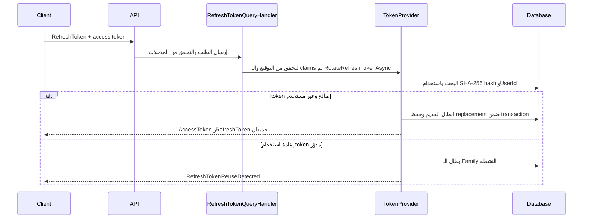
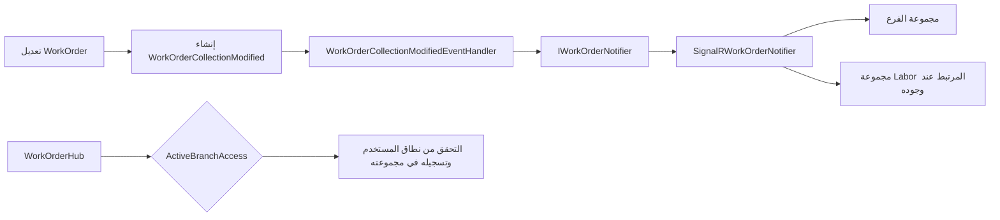

# سجل تتبّع تعديلات Production

**الأقسام:** Security، Rate Limiting، SignalR
**تاريخ المراجعة:** 2026-11-05
**الفرع وقت المراجعة:** `feature/multi-branch-rowversion`
**مصدر التوثيق:** ملفات الـworking tree الحالية. التغييرات لسه غير معمولة لها `commit` أو `push`.

## الغرض والنطاق

الملف ده بيسجل تعديلات Production الحالية في ثلاث مجموعات: حماية الهوية والـtokens، تحديد معدل الطلبات، وإشعارات `WorkOrders` باستخدام `SignalR`. أسماء الملفات والـclasses والـmethods والـproperties بتفضل زي ما هي في الكود.

الشرح مبني على الملفات الموجودة حاليًا، ومش بيفترض إن كل تغيير كان جزءًا من نفس الـcommit أو إنه اتنشر على Production. اختبارات الـtest projects وملفات الشرح المساندة مش محسوبة ككود Production.

## ملخص التغييرات

| الموضوع | المشكلة أو الهدف | السلوك بعد التعديل |
|---|---|---|
| Security | حماية مفاتيح JWT وكلمات مرور البريد، وتخزين refresh tokens وإبطالها بشكل آمن | الأسرار بقت خارج ملفات الإعدادات المتتبعة، والـrefresh tokens بتتخزن كـhashes وبتتدوّر عند الاستخدام |
| Rate Limiting | تقليل إساءة استخدام endpoints الحساسة والتحكم في الحمل على الخدمة | حدود عامة وحدود مستقلة لتسجيل الدخول وتجديد الـtoken وإنشاء الحسابات واستخدام API |
| SignalR | منع بث تغييرات أوامر الشغل لكل الاتصالات بدون تمييز | الاتصال بيتطلب `ActiveBranchAccess` والإشعار بيتوجه لمجموعة الفرع أو الـLabor المعني |

## 1. Security

### سجل التعديلات

| الملف | التعديل | السبب والأثر |
|---|---|---|
| `MechanicShop.Api/appsettings.json` | اتشال `JwtSettings:Secret` وبيانات حساب البريد من الملف المتتبع. اتضاف مستوى تسجيل `Warning` لـ`Microsoft.AspNetCore.Hosting.Diagnostics`. | مفاتيح التوقيع وبيانات البريد ما تتخزنش كأسرار صريحة في الإعدادات. خفض تسجيل فئة تشخيص الطلبات يمنع تسجيل عنوان SignalR المحتوي على `access_token` بمستوى `Information`. |
| `MechanicShop.Api/appsettings.Example.json` | ملف إعدادات نموذجي من غير مفاتيح سرية. | يوضح مفاتيح الإعداد المطلوبة من غير تضمين قيمة سرية. |
| `MechanicShop.Api/MechanicShop.Api.csproj` | إصدار `Microsoft.AspNetCore.Components.WebAssembly.Server` اتغير من `10.0.13` إلى `10.0.14`. | ده تغيير package ظاهر في الـdiff. التغيير موثق هنا من غير نسبته إلى CVE محدد؛ مفيش رقم advisory مربوط به في هذا الملف. |
| `MechanicShop.Infrastructure/Settings/JwtSettings.cs` | أضيف إعداد typed لـ`JwtSettings` وفحص `IsValid`. | الإعداد يرفض `Secret` الأقصر من 32 بايت UTF-8 أو `Issuer`/`Audience` الفارغين أو مدة token غير موجبة. |
| `MechanicShop.Infrastructure/DependencyInjection.cs` | تسجيل `JwtSettings` والتحقق منها عند بدء التطبيق. إعداد `JwtBearer` يتحقق من التوقيع والـissuer والـaudience والـlifetime، ويقبل `HS256` فقط. | التطبيق يفشل عند إعداد JWT غير صالح، ويرفض access tokens غير الموقعة أو غير المطابقة للإعدادات. قراءة `access_token` من query محصورة بمسار `/hubs/workorders`. |
| `MechanicShop.Api/Program.cs` | تم إعداد `WorkOrderHub` ليغلق الاتصال عند انتهاء صلاحية المصادقة باستخدام `CloseOnAuthenticationExpiration = true`. | اتصال SignalR ما يفضلش مفتوح بعد انتهاء صلاحية الـaccess token. تفاصيل إضافية في قسم SignalR. |
| `MechanicShop.Application/Common/Interfaces/ITokenProvider.cs` و`MechanicShop.Infrastructure/identity/TokenProvider.cs` | اتضاف `RotateRefreshTokenAsync` و`RevokeRefreshTokensAsync`. الـrefresh token العشوائي بيُرسل مرة واحدة، بينما قاعدة البيانات تحتفظ بـ`SHA-256` hash فقط. | تسريب قاعدة البيانات لا يكشف refresh tokens صالحة بصورتها الأصلية. كل refresh ناجح يصدر token جديدًا ويربطه بنفس `FamilyId`. |
| `MechanicShop.Domain/Identity/RefreshToken.cs` و`RefreshTokenErrors.cs` | الكيان يحتفظ بـ`TokenHash` و`FamilyId` ووقت الإبطال وhash الـreplacement، مع قواعد إنشاء وإبطال. | بقى ممكن التمييز بين token صالح ومنتهي أو ملغي، ورصد إعادة استعمال token تم تدويره. |
| `MechanicShop.Infrastructure/Date/Configurations/RefreshTokenConfiguration.cs` | إعداد حدود الأعمدة والفهارس، ومنها فهرس فريد على `TokenHash` وفهرس `(UserId, FamilyId)`. | يدعم البحث عن token hash ومنع تسجيل نفس الـhash مرتين. |
| `MechanicShop.Infrastructure/Migrations/20261105120000_SecureRefreshTokenStorage.cs` وملف `.Designer.cs` و`AppDbContextModelSnapshot.cs` | إضافة بيانات العائلة والإبطال والاستبدال، تحويل refresh tokens الموجودة إلى hashes، وحذف السجلات ذات token الفارغ. جرى ضبط `UserId` إلى `nvarchar(450)` ليتوافق مع النموذج والفهرس. | ترحيل قاعدة البيانات إلى شكل التخزين الجديد. شغّل الـmigration بعد أخذ نسخة احتياطية مناسبة؛ الـ`Up` يحذف فقط السجلات ذات `Token` الفارغ أو `NULL` ويحوّل الباقي. الـ`Down` يعيد عمود `Token` بقيم اصطناعية غير صالحة للاستخدام، لذلك الرجوع لا يعيد قيم tokens الأصلية. |
| `MechanicShop.Application/Features/Identity/Queries/RefreshTokens/RefreshTokenQueryHandler.cs` و`RefreshTokenQueryValidator.cs` و`MechanicShop.Application/Common/Errors/ApplicationErrors.cs` | الـhandler يعيد تحميل المستخدم من الهوية الموثوقة ثم يفوض تدوير token إلى `ITokenProvider`. الـvalidator يضع حدودًا لطول المدخلات، و`ApplicationErrors` يعرّف أخطاء انتهاء وإعادة استعمال refresh token. | لا يتم إصدار زوج tokens جديد بمجرد وجود refresh token؛ يلزم access token سليم التوقيع والـclaims وrefresh token غير منتهي وغير مستعمل للمستخدم نفسه. ملاحظة: الكود لا يشترط حاليًا أن يكون access token قد انتهت صلاحيته؛ التفاصيل موضحة بعد الرسم. |
| `MechanicShop.Api/Controllers/IdentityController.cs` و`Contracts/Requests/Identity/ChangePasswordRequest.cs` | إضافة `POST identity/logout` و`POST identity/change-password`، وكلاهما يتطلب تسجيل الدخول. | `UserId` بيتحدد من claims الحالية، وليس من قيمة يرسلها العميل. |
| `MechanicShop.Application/Features/Identity/Commands/Logout/*` و`ChangePassword/*`، و`IIdentityService.cs` و`Infrastructure/identity/IdentityService.cs` | إضافة commands وhandlers لتسجيل الخروج وتغيير كلمة المرور. تغيير كلمة المرور يتحقق من كلمة المرور الحالية ويحدّث `SecurityStamp` ويلغي refresh tokens النشطة داخل transaction. | تسجيل الخروج أو تغيير كلمة المرور يمنع استعمال refresh tokens السابقة للمستخدم. |
| `MechanicShop.Api/MechanicShop.Api.csproj` و`.gitignore` و`SECURITY.md` | المشروع يحتوي `UserSecretsId`، و`.gitignore` يستثني ملفات الأسرار و`appsettings.Development.json`، و`SECURITY.md` يشرح الإعداد. | إعدادات التطوير والأسرار المحلية ما تدخلش في Git. في بيئة الاستضافة، `JwtSettings__Secret` يتوفر من secret store أو environment variable. |

### تدفق إصدار وتجديد الـtokens

`GetPrincipalFromExpiredToken` يعطّل فحص `ValidateLifetime` عشان يقدر يقرأ claims من access token منتهي، لكنه حاليًا ما بيتأكدش أن `exp` انتهى فعلًا؛ يعني وجود access token سليم التوقيع ومعه refresh token صالح كافي للمرور حتى لو الـaccess token لسه ساري. وصف endpoint الحالي يقول إنه مخصص لتجديد token منتهي. دي ملاحظة مراجعة أمنية/سلوكية مفتوحة في الكود، مش إصلاح اتنفذ ضمن كتابة ملف التتبع.

الـrefresh tokens الجديدة صلاحيتها سبعة أيام حسب `TokenProvider`. كل تدوير ناجح يصدر refresh token جديدًا بصلاحية سبعة أيام ضمن نفس `FamilyId`.

## 2. Rate Limiting

### سجل التعديلات

| الملف | التعديل | السبب والأثر |
|---|---|---|
| `MechanicShop.Infrastructure/Settings/RateLimitSettings.cs` | إضافة إعدادات typed للحد العام وحدود السياسات، مع `IsValid` يتأكد أن كل الحدود والمدد موجبة. | يمنع تشغيل rate limit بقيم صفرية أو سالبة. |
| `MechanicShop.Api/DependencyInjection.cs` | `AddAppRateLimiting(configuration)` يقرأ الإعدادات، يسجل الخيارات ويتحقق منها عند startup، ثم ينشئ global sliding window وglobal concurrency limit وسياسات endpoint. | يجمع بين تحديد المعدل حسب IP والتحكم في عدد الطلبات المتزامنة. لا توجد طوابير انتظار للطلبات المرفوضة. |
| `MechanicShop.Api/DependencyInjection.cs` | إعداد `ForwardedHeadersOptions` يقبل `X-Forwarded-For` و`X-Forwarded-Proto` من proxies موثوقة فقط، مع التحقق من أن `KnownProxies` عناوين IP صحيحة. | يمنع الاعتماد على عنوان عميل قابل للتزوير من forwarded header غير موثوق. |
| `MechanicShop.Api/DependencyInjection.cs` و`MechanicShop.Api/Program.cs` | `UseForwardedHeaders()` يسبق قراءة عنوان العميل، و`UseRateLimiter()` يأتي بعد `UseAuthentication()` وقبل `UseAuthorization()`. | السياسات التي تعتمد على `NameIdentifier` تقدر تستخدم هوية المستخدم، بينما الحد العام يستخدم عنوان الاتصال المعتمد. |
| `MechanicShop.Api/Controllers/IdentityController.cs` | تطبيق `LoginPolicy` على `GenerateToken` و`RefreshPolicy` على `RefreshToken`. | حماية endpoints تسجيل الدخول وتجديد الـtoken بحدود منفصلة. |
| `MechanicShop.Api/Controllers/EmployeesController.cs` | تطبيق `RegisterPolicy` على إنشاء حسابات `Labor` و`Branch Manager`. | يحد من تكرار طلبات إنشاء الحسابات. |
| `MechanicShop.Api/Controllers/InvoicesController.cs` | تطبيق `ApiUserPolicy` على تنزيل Invoice PDF. | تحديد معدل استخدام endpoint المصادَق عليه المشار إليه في الـcontroller. |
| `MechanicShop.Api/appsettings.json` و`appsettings.Example.json` | إضافة قيم قابلة للضبط للحدود والمدد. القيم الحالية: عام `100` طلب/دقيقة، تزامن `50`، تسجيل الدخول `5`/دقيقة، refresh `10`/دقيقة، مستخدم API `120`/دقيقة، وإنشاء الحسابات `5`/دقيقة. | تعديل السلوك يتم من الإعدادات من غير تغيير الكود. |

### السياسات والاستجابة عند تجاوز الحد

| Policy | مفتاح التقسيم | الإعداد الحالي |
|---|---|---:|
| Global sliding window | عنوان IP | 100 في الدقيقة، مقسمة إلى 6 segments |
| Global concurrency | جميع الاتصالات | 50 اتصالًا متزامنًا |
| `LoginPolicy` | عنوان IP | 5 في الدقيقة |
| `RefreshPolicy` | عنوان IP | 10 في الدقيقة |
| `ApiUserPolicy` | `NameIdentifier`، ثم IP كاحتياط | 120 في الدقيقة |
| `RegisterPolicy` | `NameIdentifier`، ثم IP كاحتياط | 5 في الدقيقة |

عند تجاوز الحد، الاستجابة `429 Too Many Requests`. لو الـlimiter وفر قيمة `RetryAfter`، يضيف التطبيق header باسم `Retry-After`.

**إعداد النشر:** قائمة `ForwardedHeaders:KnownProxies` في المثال فاضية. لو التطبيق خلف reverse proxy، لازم تضيف عناوين IP الفعلية للـproxy الموثوق؛ غير كده الـlimiter هيعتمد على عنوان الاتصال اللي شايفه التطبيق.

## 3. SignalR

### سجل التعديلات

| الملف | التعديل | السبب والأثر |
|---|---|---|
| `MechanicShop.Infrastructure/Realtime/WorkOrderHub.cs` | إضافة `[Authorize(Policy = "ActiveBranchAccess")]`، ومجموعات `BranchGroup` و`LaborGroup`. عند الاتصال، Labor ينضم لمجموعته، وBranch Manager لفرعه، وCompany Manager للفروع النشطة. | منع الاتصال غير المصرح به وتحديد الاتصالات التي تستقبل تحديثات كل نطاق. |
| `MechanicShop.Domain/Workorders/Events/WorkOrderCollectionModified.cs` | الحدث يحمل `BranchId` و`LaborId` اختياريًا. | تمرير بيانات التوجيه اللازمة من لحظة تعديل أمر الشغل. |
| `MechanicShop.Application/Features/WorkOrders/EventHandlers/WorkOrderCollectionModifiedEventHandler.cs` و`Application/Common/Interfaces/IWorkOrderNotifier.cs` | تمرير الفرع والـLabor إلى خدمة الإشعار بدل بث عام بلا سياق. | فصل Application عن تنفيذ SignalR مع المحافظة على بيانات النطاق. |
| `MechanicShop.Infrastructure/Realtime/SignalRWorkOrderNotifier.cs` | الإرسال إلى مجموعة الفرع، وإلى مجموعة Labor المرتبط عند وجود `LaborId`؛ لم يعد الإرسال إلى `Clients.All`. | تقليل نطاق بث بيانات WorkOrders للاتصالات المعنية فقط. |
| Handlers الخاصة بـ`CreateWorkOrder` و`AssignLabor` و`DeleteWorkOrder` و`RelocateWorkOrder` و`UpdateWorkOrderState` و`UpdateWorkOrderRepairTasks` | نشر `WorkOrderCollectionModified` مع `BranchId` والـ`LaborId` بعد تجهيز التغيير وقبل `SaveChangesAsync` حسب نمط domain events الموجود. | ربط تغيير أمر الشغل بإشعار المجموعة المناسبة. |
| `MechanicShop.Infrastructure/DependencyInjection.cs` | إعداد JWT middleware لقراءة `access_token` من query فقط تحت `/hubs/workorders`. | دعم WebSocket clients التي لا تستطيع إرسال bearer header بالطريقة المعتادة، مع إبقاء الاستثناء مقصورًا على مسار Hub. |
| `MechanicShop.Api/Program.cs` | تفعيل `CloseOnAuthenticationExpiration` عند تسجيل `WorkOrderHub`. | إنهاء اتصال Hub عند انتهاء صلاحية المصادقة. |
| `MechanicShop.Api/appsettings.json` | مستوى `Microsoft.AspNetCore.Hosting.Diagnostics` مضبوط على `Warning`. | سجلات `Information` الخاصة بطلب SignalR لا تسجل query string الذي قد يحتوي على `access_token`. الإعداد يقلل أيضًا سجلات الطلبات الأخرى من نفس الفئة. |

### تدفق الإشعار

## إعداد الأسرار والتشغيل

- `JwtSettings:Secret` مطلوب وقت التشغيل، ولازم يكون 32 بايت UTF-8 على الأقل. إعداد `Issuer` و`Audience` ومدة الصلاحية مطلوبين أيضًا.
- في Development، استخدم `dotnet user-secrets` للمشروع `MechanicShop.Api`. في الاستضافة، استخدم `JwtSettings__Secret` من secret store.
- قيم `EmailSettings` مثل `SenderEmail` و`Username` و`Password` لازم تيجي من مكان محلي أو secret store، مش من ملفات Git.
- لو مفتاح JWT أو بيانات SMTP اتسجلوا سابقًا في Git، إزالة القيمة من النسخة الحالية لا تمسحها من history. اعتبرها مكشوفة ودوّرها عند مزود الخدمة.
- الـmigration بتحول refresh tokens المخزنة حاليًا. راجع قاعدة البيانات المستهدفة وخذ backup قبل تطبيقها خارج بيئة الاختبار.

## التحقق المسجل

آخر تحقق مسجل مع هذه التغييرات:

- `dotnet build MechanicShop.slnx --no-restore --maxcpucount:1`: نجح، 0 أخطاء و4 تحذيرات API Versioning/OpenAPI (`AV0016` و`AV0029` و`AV0030`).
- نتائج الاختبارات:

  | المجموعة | ناجح | فاشل | متخطّي |
  |---|---:|---:|---:|
  | Domain Unit Tests | 112 | 0 | 0 |
  | Application Unit Tests | 52 | 0 | 0 |
  | Application Subcutaneous Tests | 183 | 0 | 0 |
  | API Integration Tests | 123 | 0 | 0 |
  | **الإجمالي** | **470** | **0** | **0** |

- اختبارات API Integration استخدمت Docker/Testcontainers. سيناريو `/health` الذي يوقف SQL عمدًا ينتظر مهلة الاتصال ويؤكد `503` و`Unhealthy`؛ ظهور سجل SQL `ERR` في هذا السيناريو متوقع والاختبار ناجح.
- `git diff --check`: لم يظهر خطأ whitespace؛ ظهرت تنبيهات Git الخاصة بتحويل نهايات الأسطر من LF إلى CRLF لبعض الملفات.

## تغييرات Production خارج الأقسام الثلاثة

`MechanicShop.Infrastructure/BackGroundJobs/OverdueBookingCleanupService.cs` عليه تعديل Production منفصل لتنظيم معالجة أوامر الشغل المتأخرة، وإتاحة `ProcessOverdueWorkOrdersOnceAsync`، وحفظ التغييرات بعد المعالجة. ما فصلتش التعديل ده تحت الأقسام الثلاثة لأنه خاص بـBackground Cleanup، مش Security أو Rate Limiting أو SignalR.

## حالة الملف

الملف ده للتوثيق والتتبع فقط. ما غيّرش سلوك التطبيق، وما عملش `commit` أو `push`. راجع `git status` قبل اعتماد التغييرات لأن الـworking tree يحتوي تغييرات أخرى بالإضافة إلى ملف التوثيق.
