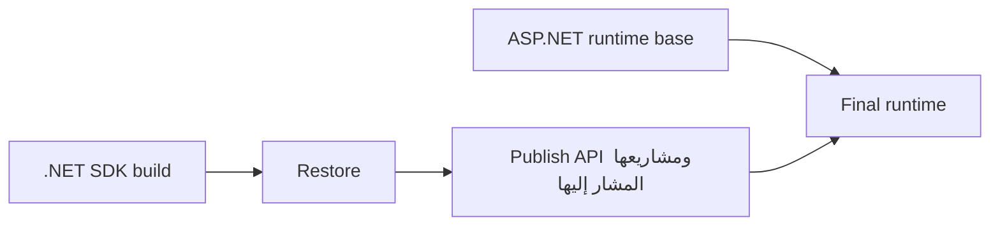

# 3. البناء متعدد المراحل

مرحلة `build` تحتوي SDK وملفات المصدر وتنتج ملفات النشر. المرحلة `final` تبدأ من صورة ASP.NET runtime وتنسخ إليها ناتج النشر فقط. بذلك لا تتضمن الصورة النهائية SDK أو ملفات المصدر أو حزم الاختبار.

مرحلة restore تعتمد على ملفات المشاريع والتكوين المركزي فقط؛ مرحلة النشر تستخدم `--no-restore` لتفادي تنزيل الحزم ثانية. سياق البناء من جذر الحل لأن API تشير إلى مشاريع أخرى عبر `ProjectReference`.

نسخ `.dockerignore` ضروري لتقليل السياق وتسريع البناء ومنع إدخال `.env` أو مخرجات بناء Windows. لا تنسخ أسرارًا إلى Dockerfile عبر `ARG` أو `COPY`؛ مرر إعدادات التشغيل من Compose أو مدير أسرار.
