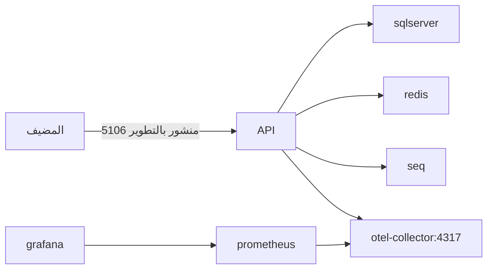

# 5. الشبكات وDNS داخل Docker

الخدمات ضمن شبكة Compose افتراضية واحدة. يتصل API بقاعدة البيانات عبر `sqlserver:1433` وبـRedis عبر `redis:6379`. Compose يوفر DNS باسم الخدمة؛ لا تستخدم `localhost` داخل API للاتصال بخدمة أخرى، لأن localhost يشير إلى حاوية API نفسها.

تُفتح واجهات المضيف من ملف override فقط. المنافذ الداخلية لا تحتاج نشرًا عامًا لتتواصل الخدمات فيما بينها. في الإنتاج استخدم شبكة خاصة وقواعد جدار ناري/وكيل عكسي مناسبًا، ولا تنشر SQL أو Redis للعامة.

منافذ Seq مختلفة: واجهة الويب على 80 داخل الحاوية وتظهر على 5341 للمضيف؛ استقبال OTLP داخل Seq على 5341 ويظهر على 5342 للمضيف عند الحاجة. API يرسل logs إلى `http://seq` ويُرسل OTLP إلى Collector على 4317.
