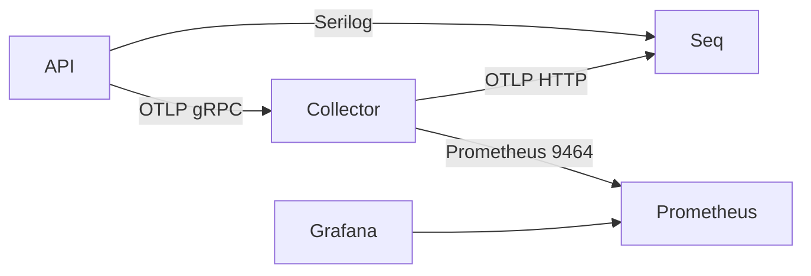

# 8. السجلات والمقاييس والتتبّع

تسلك البيانات مسارات مختلفة:

- **Logs:** إعداد Serilog في API يرسل إلى Seq عبر عنوان الخدمة `http://seq` داخل الشبكة.
- **Traces:** OpenTelemetry يضيف instrumentation لـASP.NET Core وHttpClient ثم يرسل OTLP إلى Collector؛ Collector يمررها إلى Seq.
- **Metrics:** OpenTelemetry يرسل OTLP إلى Collector؛ Prometheus يجمعها من endpoint الخاص بالـCollector؛ Grafana يعرضها.

تم ضبط resource service name إلى `MechanicShop.Api` ليكون مميزًا عن الاسم الافتراضي السابق. لا ترسل أسرارًا أو بيانات شخصية حساسة في السجلات أو tags. راقب cardinality في أسماء المقاييس ولا تستخدم معرف العميل أو الطلب كـlabel غير محدود.

لوحة Grafana الأولية تعرض scrape targets ومعدل الطلبات عندما تتوفر المقاييس ذات الصلة. إذا لم يظهر metric، تحقق أولًا من `docker compose ps` ثم سجلات `otel-collector` و`prometheus`، وبعدها من اسم الـinstrumentation والمصدر.
