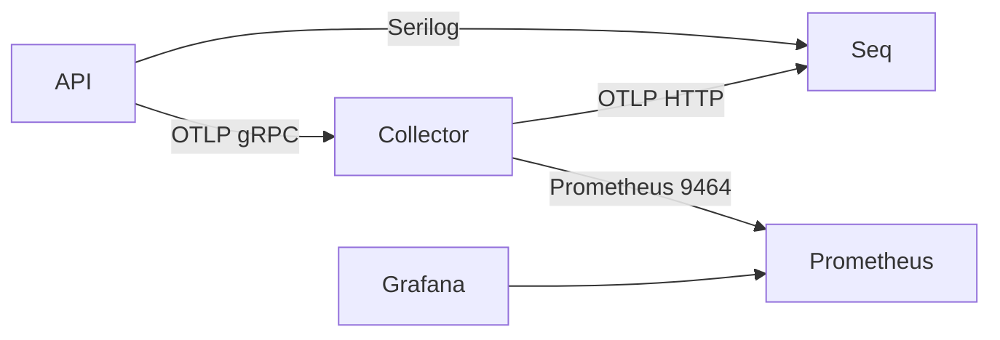

# 8. Logging, Metrics, and Tracing

Observability data follows different pipelines:

- **Logs:** Serilog is configured in the API to send logs to Seq using the service address `http://seq` within the Docker network.
- **Traces:** OpenTelemetry adds instrumentation for ASP.NET Core and HttpClient, then exports OTLP data to the Collector. The Collector forwards traces to Seq.
- **Metrics:** OpenTelemetry sends OTLP data to the Collector. Prometheus scrapes metrics from the Collector endpoint, while Grafana visualizes them.

The resource service name has been configured as `MechanicShop.Api` to distinguish it from the previous default name.

Never include secrets or sensitive personal information in logs or tags. Monitor metric cardinality and avoid using unbounded values, such as customer IDs or request IDs, as metric labels.

## Grafana Dashboard

The Grafana dashboard displays:

- Scrape targets and their health status.
- HTTP request rate.
- HTTP request duration at p95.
- HTTP 5xx error rate.
- Active HTTP requests.

These metrics are based on ASP.NET Core instrumentation collected by the application.

Currently, the application does not enable Runtime or Database metrics.

## Troubleshooting Missing Metrics

If a metric does not appear, follow these steps:

1. Check container status using `docker compose ps`.
2. Inspect the `otel-collector` container logs.
3. Inspect the `prometheus` container logs.
4. Verify the instrumentation name and metric source.
