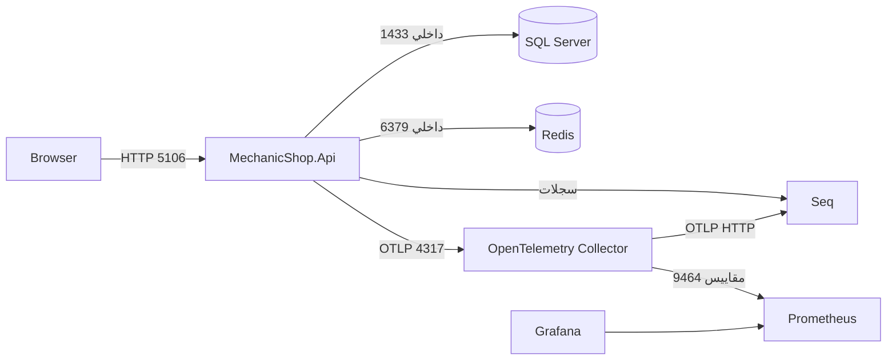

# تشغيل MechanicShop باستخدام Docker

هذا الدليل يشرح تشغيل API وقاعدة البيانات والتخزين المؤقت والمراقبة. ملفات التشغيل ومشروع Visual Studio موجودة في `docker-compose/`، بينما صورة التطبيق تُبنى من مشروع `src/MechanicShop.Api` مع سياق بناء جذر الحل.

## البنية



ملفا `docker-compose/docker-compose.yml` و`docker-compose/docker-compose.override.yml` يعرّفان الخدمات والشبكة الداخلية والتخزين الدائم ومنافذ التطوير. شغّل أوامر Compose من مجلد `docker-compose` حتى يحمّل `.env` المحلي تلقائيًا.

## التشغيل لأول مرة

1. انسخ `docker-compose/.env.example` إلى `docker-compose/.env`. يوجد ملف `.env` محلي مستبعد من Git، ويمكنك تعديله مباشرة.
2. راجع شروط تراخيص SQL Server وSeq. بعد موافقتك اكتب `Y` في `MSSQL_ACCEPT_EULA` و`SEQ_ACCEPT_EULA`.
3. أضف كلمة مرور SQL قوية، وكلمة مرور Seq وGrafana، وJWT secret عشوائيًا لا يقل عن 32 بايت UTF-8. لا تضع القيم في Git أو في التوثيق.
4. شغّل من مجلد `docker-compose`:

```powershell
docker compose config --quiet
docker compose up --build -d
docker compose ps
```

العنوان المحلي للـ API هو `http://localhost:5106`، وفحص الصحة `http://localhost:5106/health`. واجهات الأدوات: Seq على `http://localhost:5341`، Prometheus على `http://localhost:9090`، وGrafana على `http://localhost:3000`.

لتغيير المنافذ عدّل متغيرات `*_HOST_PORT` في `.env`. عند ظهور خطأ تعارض منفذ استخدم `docker compose ps` و`Get-NetTCPConnection` لمعرفة العملية التي تستخدمه.

## ملفات الإعداد

| الملف | الغرض |
| --- | --- |
| `src/MechanicShop.Api/Dockerfile` | بناء ونشر صورة Linux متعددة المراحل تعمل كمستخدم غير root. |
| `docker-compose/docker-compose.yml` | تعريف API وSQL Server وRedis وSeq وCollector وPrometheus وGrafana. |
| `docker-compose/docker-compose.override.yml` | ربط منافذ الخدمات على المضيف لتطوير محلي. |
| `docker-compose/docker-compose.dcproj` | مشروع Visual Studio 2026 وملف إعداد Compose Environment. |
| `docker-compose/.env.example` | أسماء الإعدادات المطلوبة وقيم منافذ افتراضية بلا أسرار. |
| `.dockerignore` في جذر الحل | يستبعد الملفات الحساسة والمخرجات من سياق بناء API. الملف داخل `docker-compose/` تنظيمي فقط، لأن سياق البناء هو جذر الحل. |
| `../otel-collector/otel-collector.yml` | استقبال traces/metrics وتمريرها إلى الوجهات. |
| `../prometheus/prometheus.yml` | أهداف جمع المقاييس. |
| `../grafana/provisioning/` | إعداد مصدر البيانات ولوحات Grafana تلقائيًا. |

ملف `docker-compose/.dockerignore` موجود ضمن مشروع Visual Studio حسب التنظيم المطلوب، لكنه لا يتحكم في build context. Docker يقرأ `D:\MechanicShop\.dockerignore` لأن السياق المحدد هو مجلد الحل (`..` من مجلد Compose).

## قاعدة البيانات والترقيات

يستخدم التطبيق عنوان `sqlserver,1433` وRedis على `redis:6379` داخل شبكة Compose؛ `localhost` داخل الحاوية يعني الحاوية نفسها. التطبيق يهيئ قاعدة البيانات تلقائيًا في بيئة Development فقط. في Production طبّق EF Core migrations كخطوة نشر معتمدة قبل تشغيل نسخة التطبيق الجديدة، وخذ نسخة احتياطية وفق إجراءات التشغيل لديك.

المعرّف الافتراضي `MSSQL_PID=Developer` مناسب للتطوير والاختبار فقط؛ اختر إصدار SQL وترخيصًا مناسبين للإنتاج. لا تستخدم Developer في الإنتاج التجاري.

## إيقاف الخدمات

```powershell
docker compose down
```

هذا يزيل الحاويات والشبكة ويُبقي البيانات في named volumes. لا تستخدم `docker compose down --volumes` إلا إذا كنت تقصد حذف بيانات SQL وRedis وSeq وPrometheus وGrafana نهائيًا.

## الفصول والتمارين

1. [مفاهيم Docker](01-docker-fundamentals.md)
2. [شرح Dockerfile](02-dockerfile.md)
3. [البناء متعدد المراحل](03-multistage-build.md)
4. [شرح Compose وبيئات التشغيل](04-compose.md)
5. [الشبكات وDNS داخل Docker](05-networking.md)
6. [Volumes والبيانات الدائمة](06-volumes.md)
7. [SQL Server وRedis وSeq](07-services.md)
8. [السجلات والمقاييس والتتبّع](08-observability.md)
9. [مرجع الأوامر](09-commands.md)
10. [الأمان](10-security.md)
11. [استكشاف الأخطاء](11-troubleshooting.md)
12. [خطة التعلّم والتمارين](progress-tracker.md)

## حدود التحقق المحلي

في آخر تحقق محلي شُغلت الخدمات بنجاح بعد تصحيح وسم صورة OpenTelemetry إلى `0.165.0`. نجح `docker compose config --quiet` و`docker compose up -d --build`؛ API وSQL Server وRedis وPrometheus أظهرت حالة `healthy`، وفحص `/health` أعاد SQL وRedis بحالة سليمة، كما أعاد Prometheus وGrafana HTTP 200. Collector أكد جاهزيته في سجله، وواجهة Seq استجابت HTTP 200.

مشروع Visual Studio Compose بُني بنجاح عبر MSBuild 2026، لكن تجربة ضغط F5 من واجهة Visual Studio نفسها لم تُنفذ آليًا.
