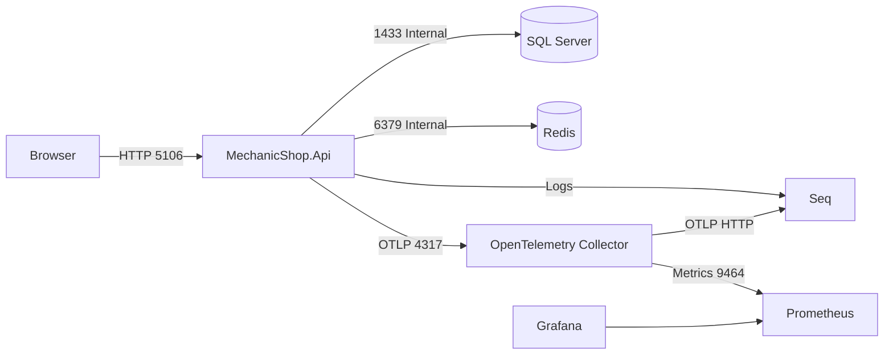

# Running MechanicShop with Docker

This guide explains how to run the API, database, caching service, and monitoring stack using Docker.

The Docker configuration files and Visual Studio Compose project are located in `docker-compose/`, while the application image is built from `src/MechanicShop.Api` using the solution root as the build context.

## Architecture



The following files define the services, internal network, persistent storage, and development ports:

- `docker-compose/docker-compose.yml`
- `docker-compose/docker-compose.override.yml`

Run Compose commands from the `docker-compose` directory to automatically load the local `.env` file.

## First-Time Setup

1. Copy `docker-compose/.env.example` to `docker-compose/.env`. A local `.env` file already exists and is excluded from Git, so you can modify it directly.
2. Review the SQL Server and Seq license agreements. After accepting them, set `MSSQL_ACCEPT_EULA` and `SEQ_ACCEPT_EULA` to `Y`.
3. Configure a strong SQL Server password, Seq password, Grafana password, and a random JWT secret containing at least 32 bytes of UTF-8 data. Never commit these values to Git or include them in documentation.
4. Run the following commands from the `docker-compose` directory:

```powershell
docker compose config --quiet
docker compose up --build -d
docker compose ps
```

### Local Access

| Service | URL |
|---|---|
| API | http://localhost:5106 |
| API Health Check | http://localhost:5106/health |
| Seq | http://localhost:5341 |
| Prometheus | http://localhost:9090 |
| Grafana | http://localhost:3000 |

To change the ports, modify the corresponding `*_HOST_PORT` variables in `.env`.

If a port conflict occurs, use `docker compose ps` and `Get-NetTCPConnection` to identify the process occupying that port.

## Configuration Files

| File | Purpose |
|---|---|
| `src/MechanicShop.Api/Dockerfile` | Builds and publishes a multi-stage Linux image that runs as a non-root user. |
| `docker-compose/docker-compose.yml` | Defines API, SQL Server, Redis, Seq, Collector, Prometheus, and Grafana services. |
| `docker-compose/docker-compose.override.yml` | Maps service ports to the host machine for local development. |
| `docker-compose/docker-compose.dcproj` | Visual Studio 2026 project and Compose Environment configuration. |
| `docker-compose/.env.example` | Documents required configuration variables and default port values without exposing secrets. |
| `.dockerignore` at the solution root | Excludes sensitive files and build outputs from the API build context. The file inside `docker-compose/` is organizational only because the build context is the solution root. |
| `docker-compose/otel-collector/otel-collector.yml` | Configures trace and metric reception and forwards telemetry to the appropriate destinations. |
| `docker-compose/prometheus/prometheus.yml` | Defines metric scraping targets. |
| `docker-compose/grafana/provisioning/` | Automatically configures Grafana data sources and dashboards. |

The `docker-compose/.dockerignore` file is included in the Visual Studio project structure as requested, but it does not control the Docker build context.

Docker reads `D:\MechanicShop\.dockerignore` because the configured build context is the solution root (`..` relative to the Compose directory).

## Database and Migrations

The application connects to SQL Server using `sqlserver,1433` and Redis using `redis:6379` within the Docker Compose network.

Inside a container, `localhost` refers to the container itself, not another service.

The application automatically initializes the database in the Development environment only.

In Production, apply EF Core migrations as an approved deployment step before starting the new application version. Make sure to create a database backup according to your operational procedures.

The default `MSSQL_PID=Developer` configuration is suitable for development and testing only.

Choose an appropriate SQL Server edition and license for production. Do not use the Developer edition in commercial production environments.

## Stopping Services

```powershell
docker compose down
```

This command removes containers and the Compose network while preserving data stored in named volumes.

**Warning:** Do not use `docker compose down --volumes` unless you intentionally want to permanently delete SQL Server, Redis, Seq, Prometheus, and Grafana volume data.

## Local Verification Results

During the latest local verification, all services started successfully after correcting the OpenTelemetry image tag to `0.165.0`.

The following checks were completed successfully:

- `docker compose config --quiet` completed successfully.
- `docker compose up -d --build` completed successfully.
- API, SQL Server, Redis, and Prometheus reported `healthy` status.
- The `/health` endpoint reported healthy SQL Server and Redis connections.
- Prometheus and Grafana returned HTTP 200.
- The Collector confirmed successful startup in its logs.
- The Seq web interface returned HTTP 200.

The Visual Studio Compose project also built successfully using MSBuild 2026.

However, pressing F5 directly from the Visual Studio interface was not tested automatically.
